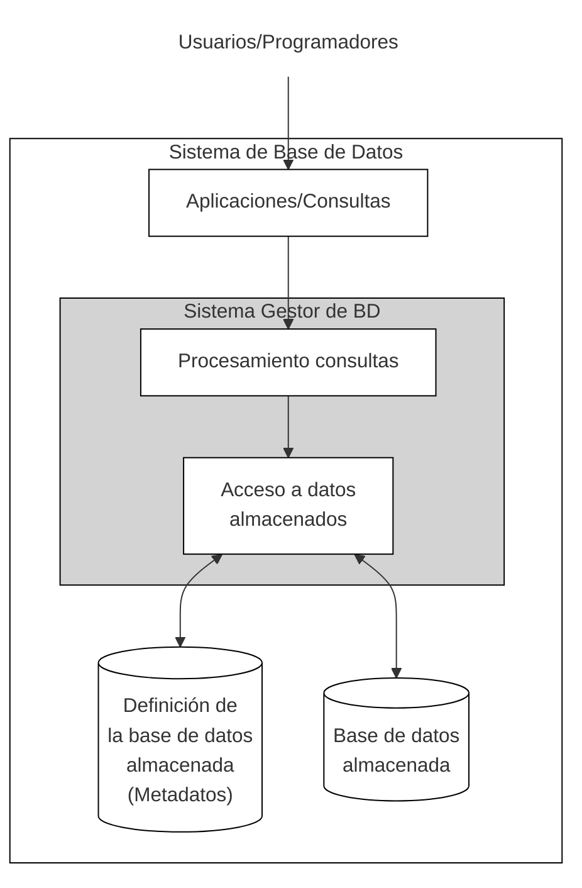

## Relación como Producto Cartesiano

Una relación de un conjunto 𝐴 a un conjunto 𝐵 es un subconjunto 𝐴 ×𝐵. Por lo tanto, una relación 𝑅 consiste en pares ordenados (𝑎,𝑏), donde 𝑎 ∈𝐴 y 𝑏 ∈𝐵. Si (𝑎,𝑏) ∈𝑅, decimos que _están relacionados_, y también se escribe 𝑎𝑅𝑏.

Ejemplo Estudiante:
**Dominios:**
	- $D_1$ = {nombres válidos} = {"Ana", "Carlos", "María", "Pedro", ...}
	- $D_2$ = {edades válidas} = {18, 19, 20, 21, 22, ...}
	- $D_3$ = {carreras} = {"Informática", "Matemáticas", "Física", ...}

**Producto cartesiano $D_1 \times D_2 \times D_3$** incluiría todas las combinaciones posibles.
**La relación ESTUDIANTE** es un subconjunto específico que contiene solo las tuplas que representan estudiantes reales:
### Conceptos Clave

- **Grado**: número de dominios (en el ejemplo, grado 3)
- **Cardinalidad**: número de tuplas en la relación (en el ejemplo, 4)
- **Esquema**: estructura de la relación con nombres de atributos
- **Instancia**: conjunto actual de tuplas.

| Informal         | Formal           |
| ---------------- | ---------------- |
| Tabla            | Relación         |
| Nombre columna   | Atributo         |
| Tipo columna     | Dominio          |
| Fila             | Tupla            |
| Definición tabla | Esquema relación |
| Datos tabla      | Estado relación  |
El **esquema o descripción** de una relación viene denotado por R(A1,A2,A3,...), donde R es el nombre de la relación y los atributos de la relación son A1,A2,A3..,An. Cada atributo tiene un dominio por ejemplo en un cliente(id, nombre,dirección,teléfono) cliente es el nombre de la relación y un ejemplo de dominio del atributo id puede ser 6 dígitos.

La **tupla** es un conjunto ordenado de valores, que tiene un componente para cada uno de los atributos de la relación, cada valor deriva de un dominio apropiado.
Una fila en la relación Cliente es una tupla de grado 4 (tiene 4 valores).

Los valores en una tupla:
	- deben ser **atómicos** (indivisibles)
	- deben ser **del dominio del atributo**
	- pueden ser valores nulos. El valor **nulo (NULL)** representa valores desconocidos, no disponibles o inaplicables en determinadas tuplas. Por regla general, se deben evitar valores null tanto como sea posible en el diseño de bases de datos.

El **dominio** tiene que tener, una definición lógica, un tipo de datos o un formato definido para él. El nombre del atributo designa el papel que desempeña un dominio en una relación.

El **estado** o instancia de una relación, es un subconjunto del producto cartesiano de los dominios de sus atributos. Ejemplo de estado:
 Sea $R(A_1, A_2)$ un esquema de relación:
	- Sea $dom(A_1) = {0,1}$
	- Sea $dom(A_2) = {a,b,c}$

- Entonces: $dom(A_1) \times dom(A_2)$ son todas las combinaciones posibles:
	{(0,a), (0,b), (0,c), (1,a), (1,b), (1,c)}

- El estado de relación es  $r(R) \subseteq dom(A_1) \times dom(A_2)$
- Por ejemplo: $r(R)$ podría ser {(0,a), (0,b), (1,c)}
	- este es un posible estado (o “población” o “extensión” ) r de la relación R, definida sobre $A_1$ y $A_2$.
	- tiene tres tuplas de grado 2: (0,a), (0,b), (1,c)


| Categoría                 | Tipo de Dato                          | Descripción                            | Soporte SQLite                     |
| ------------------------- | ------------------------------------- | -------------------------------------- | ---------------------------------- |
| **Numéricos Enteros**     | `SMALLINT`                            | Entero pequeño (típicamente 2 bytes)   | ✅ Sí (como INTEGER)                |
|                           | `INTEGER` / `INT`                     | Entero estándar (típicamente 4 bytes)  | ✅ Sí (tipo nativo)                 |
|                           | `BIGINT`                              | Entero grande (típicamente 8 bytes)    | ✅ Sí (como INTEGER)                |
| **Numéricos Decimales**   | `DECIMAL(p,s)` / `NUMERIC(p,s)`       | Numérico exacto con precisión y escala | ⚠️ Parcial (almacenado como REAL)  |
|                           | `REAL`                                | Punto flotante de precisión simple     | ✅ Sí (tipo nativo)                 |
|                           | `DOUBLE PRECISION` / `FLOAT`          | Punto flotante de doble precisión      | ✅ Sí (como REAL)                   |
| **Cadenas de Caracteres** | `CHARACTER(n)` / `CHAR(n)`            | Cadena de longitud fija                | ✅ Sí (como TEXT)                   |
|                           | `CHARACTER VARYING(n)` / `VARCHAR(n)` | Cadena de longitud variable            | ✅ Sí (como TEXT)                   |
|                           | `TEXT`                                | Cadena de longitud variable            | ✅ Sí (tipo nativo)                 |
| **Fecha y Hora**          | `DATE`                                | Fecha (año, mes, día)                  | ❌ No (usar TEXT o INTEGER)         |
|                           | `TIME`                                | Hora del día                           | ❌ No (usar TEXT o INTEGER)         |
|                           | `TIMESTAMP`                           | Fecha y hora combinadas                | ❌ No (usar TEXT o INTEGER)         |
|                           | `INTERVAL`                            | Intervalo de tiempo                    | ❌ No                               |
| **Booleano**              | `BOOLEAN`                             | Valores verdadero/falso                | ❌ No (usar INTEGER 0/1)            |
| **Datos Binarios**        | `BINARY(n)`                           | Datos binarios de longitud fija        | ✅ Sí (como BLOB)                   |
|                           | `VARBINARY(n)`                        | Datos binarios de longitud variable    | ✅ Sí (como BLOB)                   |
|                           | `BLOB`                                | Objeto Binario Grande                  | ✅ Sí (tipo nativo)                 |
| **Adicionales**           | `CLOB`                                | Objeto de Caracteres Grande            | ✅ Sí (como TEXT)                   |
|                           | `XML`                                 | Datos XML                              | ❌ No (usar TEXT)                   |
|                           | `JSON`                                | Datos JSON                             | ⚠️ Parcial (usar TEXT, JSON1 ext.) |
|                           | `ARRAY`                               | Tipo array                             | ❌ No                               |

## Creación de tablas 


Consiste en definir todas las relaciones como tablas SQL

```sql
CREATE TABLE EMPLEADO (	
	nombre VARCHAR(40) NOT NULL,
	apellido1 VARCHAR(30) NOT NULL,
	apellido2 VARCHAR(30),
	dni VARCHAR(10) NOT NULL,
	fechaNac DATE NOT NULL,
	direccion VARCHAR(150),
	sexo CHAR(1) NOT NULL,
	sueldo NUMERIC(12,2) NOT NULL,
	supervisor VARCHAR(10),
	dpto INTEGER NOT NULL
);

```

## Restricciones del modelo relacional

**Tipos de restricciones**:

>[!info] Superclave y clave 
> - Cualquier clave es una superclave (pero no al revés)
> - Cualquier conjunto de atributos que incluya una clave es una superclave.
> - Una superclave mínima también es una clave.

- Restricciones inherentes o **implícitas**: el modelo relacional no permite una lista como valor para ningún atributo y tampoco permite tener tuplas duplicadas.
- Restricciones **explícitas** o **basadas en esquema**:
	1. Restricciones de **dominio**: cada valor de la dupla debe ser atómico (un único valor en la tupla) y del dominio de su atributo
	2. Restricciones de **clave**:
		* Por superclave SK de R: la superclave es cualquier combinación de datos que garantiza que jamás habrá dos filas  idénticas en la base de datos. Da igual si lleva datos de más (redundantes) lo importante es que no se repite
		* Clave K de R: K es una superclave mínima (número de atributos), la eliminación de cualquier atributo de $K$ da como resultado un conjunto de atributos que deja de ser superclave.
		* Clave candidata: cuando una relación tiene varias claves candidatas, se elige una como clave primaria y las demás serán claves alternativas.
		* Atributo primo: es un atributo que forma parte de al menos una clave candidata
	3. Restricciones de **integridad de entidad**: los atributos de clave primarioa de cada esquema de relación no pueden tener valores nulos
	4. Restricciones de **integridad referencial**:  restricción entre dos relaciones (la referenciante y la referenciada), la referenciada tiene la PK, la referenciante es la tabla que necesita conectarse con la referenciada, guarda la clave externa FK esta puede ser clave primaria de la tabla o nulo, si es nulo no podría ser clave primaria.
- Restricciones semánticas o basadas en aplicaciones: Basadas en la semántica de aplicación, el modelo no tiene suficiente expresividad para representarlas.  Ejemplo: “el máximo número de horas por empleado para todos los proyectos en los que trabaja es de 56 horas por semana"
