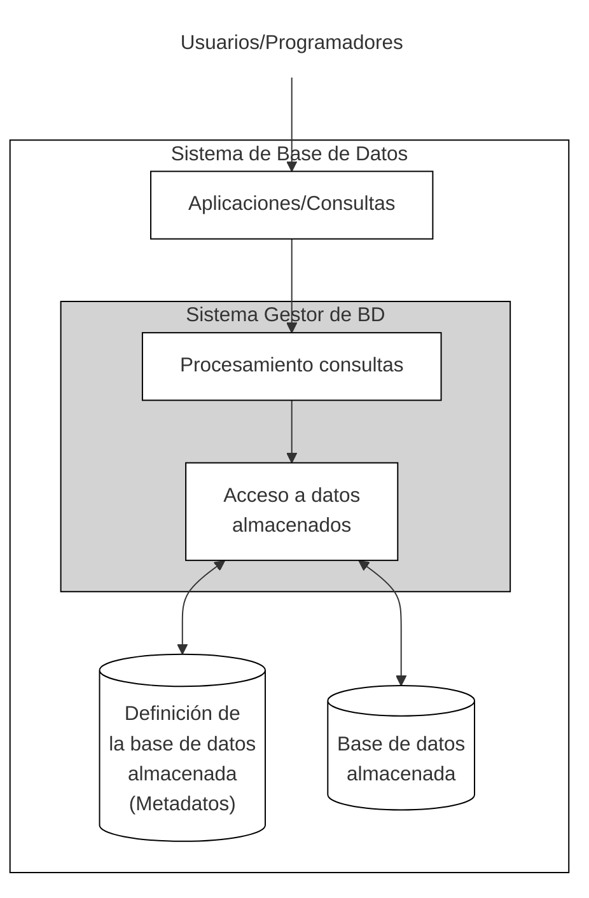

# Tema 2: Modelo Relacional




## Relación como Producto Cartesiano

Una relación de un conjunto 𝐴 a un conjunto 𝐵 es un subconjunto 𝐴 ×𝐵. Por lo tanto, una relación 𝑅 consiste en pares ordenados (𝑎,𝑏), donde 𝑎 ∈𝐴 y 𝑏 ∈𝐵. Si (𝑎,𝑏) ∈𝑅, decimos que _están relacionados_, y también se escribe 𝑎𝑅𝑏.

Ejemplo Estudiante:
**Dominios:**
	- $D_1$ = {nombres válidos} = {"Ana", "Carlos", "María", "Pedro", ...}
	- $D_2$ = {edades válidas} = {18, 19, 20, 21, 22, ...}
	- $D_3$ = {carreras} = {"Informática", "Matemáticas", "Física", ...}

**Producto cartesiano $D_1 \times D_2 \times D_3$** incluiría todas las combinaciones posibles.
**La relación ESTUDIANTE** es un subconjunto específico que contiene solo las tuplas que representan estudiantes reales:
### Conceptos Clave

- **Grado**: número de dominios (en el ejemplo, grado 3)
- **Cardinalidad**: número de tuplas en la relación (en el ejemplo, 4)
- **Esquema**: estructura de la relación con nombres de atributos
- **Instancia**: conjunto actual de tuplas.

| Informal         | Formal           |
| ---------------- | ---------------- |
| Tabla            | Relación         |
| Nombre columna   | Atributo         |
| Tipo columna     | Dominio          |
| Fila             | Tupla            |
| Definición tabla | Esquema relación |
| Datos tabla      | Estado relación  |
El **esquema o descripción** de una relación viene denotado por R(A1,A2,A3,...), donde R es el nombre de la relación y los atributos de la relación son A1,A2,A3..,An. Cada atributo tiene un dominio por ejemplo en un cliente(id, nombre,dirección,teléfono) cliente es el nombre de la relación y un ejemplo de dominio del atributo id puede ser 6 dígitos.

La **tupla** es un conjunto ordenado de valores, que tiene un componente para cada uno de los atributos de la relación, cada valor deriva de un dominio apropiado.
Una fila en la relación Cliente es una tupla de grado 4 (tiene 4 valores).

Los valores en una tupla:
	- deben ser **atómicos** (indivisibles)
	- deben ser **del dominio del atributo**
	- pueden ser valores nulos. El valor **nulo (NULL)** representa valores desconocidos, no disponibles o inaplicables en determinadas tuplas. Por regla general, se deben evitar valores null tanto como sea posible en el diseño de bases de datos.

El **dominio** tiene que tener, una definición lógica, un tipo de datos o un formato definido para él. El nombre del atributo designa el papel que desempeña un dominio en una relación.

El **estado** o instancia de una relación, es un subconjunto del producto cartesiano de los dominios de sus atributos. Ejemplo de estado:
 Sea $R(A_1, A_2)$ un esquema de relación:
	- Sea $dom(A_1) = {0,1}$
	- Sea $dom(A_2) = {a,b,c}$

- Entonces: $dom(A_1) \times dom(A_2)$ son todas las combinaciones posibles:
	{(0,a), (0,b), (0,c), (1,a), (1,b), (1,c)}

- El estado de relación es  $r(R) \subseteq dom(A_1) \times dom(A_2)$
- Por ejemplo: $r(R)$ podría ser {(0,a), (0,b), (1,c)}
	- este es un posible estado (o “población” o “extensión” ) r de la relación R, definida sobre $A_1$ y $A_2$.
	- tiene tres tuplas de grado 2: (0,a), (0,b), (1,c)


| Categoría                 | Tipo de Dato                          | Descripción                            | Soporte SQLite                     |
| ------------------------- | ------------------------------------- | -------------------------------------- | ---------------------------------- |
| **Numéricos Enteros**     | `SMALLINT`                            | Entero pequeño (típicamente 2 bytes)   | ✅ Sí (como INTEGER)                |
|                           | `INTEGER` / `INT`                     | Entero estándar (típicamente 4 bytes)  | ✅ Sí (tipo nativo)                 |
|                           | `BIGINT`                              | Entero grande (típicamente 8 bytes)    | ✅ Sí (como INTEGER)                |
| **Numéricos Decimales**   | `DECIMAL(p,s)` / `NUMERIC(p,s)`       | Numérico exacto con precisión y escala | ⚠️ Parcial (almacenado como REAL)  |
|                           | `REAL`                                | Punto flotante de precisión simple     | ✅ Sí (tipo nativo)                 |
|                           | `DOUBLE PRECISION` / `FLOAT`          | Punto flotante de doble precisión      | ✅ Sí (como REAL)                   |
| **Cadenas de Caracteres** | `CHARACTER(n)` / `CHAR(n)`            | Cadena de longitud fija                | ✅ Sí (como TEXT)                   |
|                           | `CHARACTER VARYING(n)` / `VARCHAR(n)` | Cadena de longitud variable            | ✅ Sí (como TEXT)                   |
|                           | `TEXT`                                | Cadena de longitud variable            | ✅ Sí (tipo nativo)                 |
| **Fecha y Hora**          | `DATE`                                | Fecha (año, mes, día)                  | ❌ No (usar TEXT o INTEGER)         |
|                           | `TIME`                                | Hora del día                           | ❌ No (usar TEXT o INTEGER)         |
|                           | `TIMESTAMP`                           | Fecha y hora combinadas                | ❌ No (usar TEXT o INTEGER)         |
|                           | `INTERVAL`                            | Intervalo de tiempo                    | ❌ No                               |
| **Booleano**              | `BOOLEAN`                             | Valores verdadero/falso                | ❌ No (usar INTEGER 0/1)            |
| **Datos Binarios**        | `BINARY(n)`                           | Datos binarios de longitud fija        | ✅ Sí (como BLOB)                   |
|                           | `VARBINARY(n)`                        | Datos binarios de longitud variable    | ✅ Sí (como BLOB)                   |
|                           | `BLOB`                                | Objeto Binario Grande                  | ✅ Sí (tipo nativo)                 |
| **Adicionales**           | `CLOB`                                | Objeto de Caracteres Grande            | ✅ Sí (como TEXT)                   |
|                           | `XML`                                 | Datos XML                              | ❌ No (usar TEXT)                   |
|                           | `JSON`                                | Datos JSON                             | ⚠️ Parcial (usar TEXT, JSON1 ext.) |
|                           | `ARRAY`                               | Tipo array                             | ❌ No                               |

## Creación de tablas 


Consiste en definir todas las relaciones como tablas SQL

```sql
CREATE TABLE EMPLEADO (	
	nombre VARCHAR(40) NOT NULL,
	apellido1 VARCHAR(30) NOT NULL,
	apellido2 VARCHAR(30),
	dni VARCHAR(10) NOT NULL,
	fechaNac DATE NOT NULL,
	direccion VARCHAR(150),
	sexo CHAR(1) NOT NULL,
	sueldo NUMERIC(12,2) NOT NULL,
	supervisor VARCHAR(10),
	dpto INTEGER NOT NULL
);

```

## Restricciones del modelo relacional

**Tipos de restricciones**:

>[!info] Superclave y clave 
> - Cualquier clave es una superclave (pero no al revés)
> - Cualquier conjunto de atributos que incluya una clave es una superclave.
> - Una superclave mínima también es una clave.

- Restricciones inherentes o **implícitas**: el modelo relacional no permite una lista como valor para ningún atributo y tampoco permite tener tuplas duplicadas.
- Restricciones **explícitas** o **basadas en esquema**:
	1. Restricciones de **dominio**: cada valor de la dupla debe ser atómico (un único valor en la tupla) y del dominio de su atributo
	2. Restricciones de **clave**:
		* Por superclave SK de R: la superclave es cualquier combinación de datos que garantiza que jamás habrá dos filas  idénticas en la base de datos. Da igual si lleva datos de más (redundantes) lo importante es que no se repite
		* Clave K de R: K es una superclave mínima (número de atributos), la eliminación de cualquier atributo de $K$ da como resultado un conjunto de atributos que deja de ser superclave.
		* Clave candidata: cuando una relación tiene varias claves candidatas, se elige una como clave primaria y las demás serán claves alternativas.
		* Atributo primo: es un atributo que forma parte de al menos una clave candidata
	3. Restricciones de **integridad de entidad**: los atributos de clave primaria de cada esquema de relación no pueden tener valores nulos
	4. Restricciones de **integridad referencial**:  restricción entre dos relaciones (la referenciante y la referenciada), la referenciada tiene la PK, la referenciante es la tabla que necesita conectarse con la referenciada, guarda la clave externa FK esta puede ser clave primaria de la tabla o nulo, si es nulo no podría ser clave primaria.
- Restricciones semánticas o basadas en aplicaciones: Basadas en la semántica de aplicación, el modelo no tiene suficiente expresividad para representarlas.  Ejemplo: “el máximo número de horas por empleado para todos los proyectos en los que trabaja es de 56 horas por semana"


## Operaciones de actualización de datos
Las operaciones de modificación no deben violar las restricciones de integridad, en caso de que pase se pueden tomar varias opciones:
* Cancelar la operación: NO ACTION (permite la operación y verifica al final la integridad. Si hay violación, se deshacen los cambios). RESTRICT (rechaza la operación si se viola la integridad. Se verifica antes de realizar la operación).
* Lanzar actualizaciones adicionales para corregir la infracción.
	* CASCADE: propaga la modificación a otras tablas
	* SET NULL: pone a NULL una clave externa si su clave primaria referenciada se ve modificada. La clave externa debe admitir valores NULL.
	* SET DEFAULT: pone el valor por defecto en una clave externa si su clave primaria referenciada se ve modificada. El valor por defecto debe estar especificado.

### Posibles infracciones al insertar 

- Restricción de **dominio**: si uno de los valores de atributo proporcionados para la nueva tupla no pertenece al dominio del atributo especificado
- Restricción de **clave**: si el valor de un atributo clave en la nueva tupla ya existe en otra tupla en la relación
- Restricción de **integridad referencial**: si un valor de clave externa en la nueva tupla hace referencia a un valor de clave primaria que no existe en la relación referenciada
- Restricción de **integridad de la entidad**: si el valor de la clave primaria es nulo en la nueva tupla

### Posibles violaciones al borrar

BORRAR puede violar sólo la integridad referencial:
	- Si el **valor de clave primaria de la tupla** que se está eliminando es **referenciada desde otras tuplas**

- Puede solucionarse mediante varias acciones: 
	- Opción RESTRICT o NO ACTION: rechazar la eliminación
	- Opción CASCADE: propagar el borrado eliminando las tuplas referenciantes
	- Opción SET NULL: poner  a NULL las claves externas de las tuplas referenciantes
	- Opción SET DEFAULT: poner a un valor por defecto válido las claves externas de las tuplas referenciantes

### Posibles violaciones al MODIFICAR

MODIFICAR puede violar cualquiera de las restricciones de integridad, dependiendo del atributo que se actualice:
	- Actualización de la clave principal (PK):
		- Similar a BORRAR seguido de INSERTAR
		- Especificar opciones similares a BORRAR en el diseño de la base de datos:
			- Opción RESTRICT o NO ACTION: rechazar la modificación
			- Opción CASCADE: propagar la modificación modificando las tuplas referenciantes
			- Opción SET NULL: poner  a NULL las claves externas de las tuplas referenciantes
			- Opción SET DEFAULT: poner a un valor por defecto válido las claves externas de las tuplas referenciantes
	- Actualización de una clave externa (FK):
		- Puede violar la integridad referencial
	- Actualización de un atributo ordinario (ni PK ni FK):
		- Puede violar las restricciones del dominio, NOT NULL y UNIQUE


# TEMA 3: Algebra relacional
Operaciones
==SE LEE LA OPERACION DE DENTRO A AFUERA==

El álgebra relacional consta de varios grupos de operaciones
- Operaciones relacionales **unarias**
	- **SELECCIÓN** (símbolo:  $\sigma$ (sigma))
	- **PROYECCIÓN** (símbolo: $\pi$ (pi))
	- **RENOMBRADO** (símbolo: $\rho$ (rho))
- Operaciones binarias de la teoría de conjuntos
	- **UNIÓN** ( $\cup$ )
	- **INTERSECCIÓN** ( $\cap$ )
	- **DIFERENCIA** (o MENOS, - )
	- **PRODUCTO CARTESIANO** (símbolo $\times$ )
- Operaciones relacionales binarias
	- **CONCATENACIÓN (INNER JOIN)** ( símbolo: $\Join$ (natural join/$\theta$-join))
	- **DIVISIÓN**
	- **CONCATENACIÓN EXTERNA (OUTER JOIN)** (símbolos: $\unicode{x27D5}$ $\unicode{x27D6}$ $\unicode{x27D7}$ ([left/right/full] outer join))
	- **AGRUPAMIENTO** (símbolo:  $\gamma$ (gamma))
	- **ORDENACIÓN** (símbolo: $\tau$ (tau))

Para poder practicar con las operaciones del álgebra relacional sobre la base de datos de empresa puedes usar este recurso web:  
[cálculadora con esquema y estado de EMPRESA](https://dbis-uibk.github.io/relax/calc/gist/5e3b094713c94df48e314477b0b1945b)

### Operaciones relacionales unarias

Las operaciones relacionales unarias tienen como operando una sola relación. Y son:
	- SELECCIÓN (SELECT) cuyo símbolo es  $\sigma$ (sigma) -> 𝜎<𝑐𝑜𝑛𝑑𝑖𝑐𝑖ó𝑛>(𝑅)
		- el símbolo $\sigma$ (sigma) se utiliza para denotar el operador de selección
		- la condición es una expresión booleana especificada sobre los atributos de la relación $R$
		- Se seleccionan las tuplas que hacen que la condición sea verdadera: aparecen en el resultado de la operación
		- Las tuplas que hacen que la condición sea falsa se filtran: descartadas del resultado de la operación
		- $\sigma_{<condición>}(R)$ **produce una relación $S$ que tiene el mismo esquema** (mismos atributos) que $R$
		- Es **conmutativa**: $$\sigma_{<condición1>}(\sigma_{<condición2>}(R)) = \sigma_{<condición2>}(\sigma_{<condición1>}(R))$$
		- Una **secuencia** de operaciones SELECT puede ser reemplazada por **una única selección con una conjunción de todas las condiciones**:$$\sigma_{<cond1>}(\sigma_{<cond2>}(\sigma_{<cond3>}(R))) = \sigma_{<cond1 \land cond2 \land cond3>}(R)$$
		- El **número de tuplas en el resultado** de una SELECT es **menor que (o igual** a) el número de tuplas en la relación de entrada $R$ 
	- PROYECCIÓN (PROJECTION) cuyo símbolo es $\pi$ (pi): **devuelve ciertas columnas** (atributos) de una relación y descarta las otras, crea una **partición vertical**. **Elimina cualquier tupla duplicada**.
		- El **resultado** de la operación del proyección debe ser una **relación** (conjunto de tuplas).
		- Los conjuntos matemáticos no permiten elementos duplicados.
		- El **número de tuplas en el resultado** de la proyección  $\pi_{<lista>}(R)$ siempre es **menor o igual al número de tuplas en $R$**
		- La proyección no es conmutativa
		- 
	- RENOMBRADO (RENAME) cuyo símbolo es $\rho$ (rho))


### Operaciones de la teoría de conjuntos
#### Unión
- Operación **binaria**, denotada por $\cup$
- El resultado de la operación $R \cup S$, es una relación que incluye todas las tuplas que están en $R$ o en $S$ o en $R$ y $S$.
	- Los nombres de los atributos en el resultado serán los mismos que los nombres de los atributos en R
- Se **eliminan las tuplas duplicadas**
- Las dos **relaciones** operandos R y S deben ser **compatibles**

#### Intersección
- Operación **binaria**, denotada por $\cap$
- El resultado de la operación $R \cap S$, es una relación que incluye todas las tuplas que están tanto en $R$ como en $S$.
	- Los nombres de los atributos en el resultado serán los mismos que los nombres de los atributos en R
- Las dos **relaciones** operandos R y S deben ser **compatibles**

#### Diferencia
- Operación **binaria**, denotada por -
- El resultado de la operación $R - S$, es una relación que incluye todas las tuplas que están  en $R$ pero no en $S$.
	- Los nombres de los atributos en el resultado serán los mismos que los nombres de los atributos en R
- Las dos **relaciones** operandos R y S deben ser **compatibles**


#### Propiedades de Unión, Intersección y Diferencia

1. Tanto la **unión** como la **intersección** son operaciones **conmutativas**:
$$R \cup S = S \cup R$$  
$$R \cap S = S \cap R$$

2. Tanto la **unión** como la **intersección** son operaciones **asociativas**:
$$R \cup (S \cup T) = (R \cup S) \cup T$$
$$(R \cap S) \cap T = R \cap (S \cap T)$$

3. La operación **diferencia no es conmutativa**; es decir, en general
$$R-S \not= S-R$$
==DOS RELACIONES SON COMPATIBLES SI TIENEN EL MISMO GRADO Y DOMINIO COMPATIBLES ATRIBUTO A ATRIBUTO==


### Producto cartesiano
- Esta operación se utiliza para **combinar tuplas de dos relaciones de forma combinatoria**.
	- Denotado por $R(A_1, A_2, \dots, A_n) x S(B_1, B_2, \dots, B_m)$
- El **resultado** es una **relación Q con grado de atributos n + m**:
$$Q(A_1, A_2, \dots, A_n, B_1, B_2, \dots, B_m)$$

### Operaciones relacionales binarias

#### Inner Join
- La secuencia PRODUCTO CARTESIANO seguida de SELECCIÓN se utiliza con frecuencia para identificar y seleccionar tuplas relacionadas de dos relaciones.
- Una operación especial, llamada CONCATENACIÓN, combina esta secuencia en una sola operación.
- Muy importante para cualquier base de datos relacional con más de una relación, porque nos permite combinar tuplas relacionadas de varias relaciones.
- La forma general de una operación de concatenación en dos relaciones $R(A_1, A_2, \dots, A_n)$ y $S(B_1, B_2, \dots, B_m)$ es:
$$R \Join_{<condición\ de\ unión>} S$$
donde $R$ y $S$ pueden ser cualquier relación que resulte de expresiones del álgebra relacional general.

## Expresando restricciones en álgebra relacional

>[!example] Ejemplo en base de datos Empresa
>Por ejemplo, en nuestra base de datos de Empresa, si una tupla `Familiar` incluye al empleado `123456789` en el atributo `empleado`, esperaríamos que `123456789` apareciera como el dni de alguna tupla de la relación `EMPLEADO`. 

Podemos expresar esta restricción de integridad en álgebra relacional como:
$$\pi_A(R) \subseteq \pi_B (S)$$
, o de forma equivalente,
$$\pi_A(R) - \pi_B (S) = \emptyset$$

# TEMA 4: Normalización

El **objetivo** del diseño lógico en el modelo relacional es **reducir el espacio de almacenamiento** que ocupa nuestra base de datos. Por lo tanto, un buen diseño lógico debe **evitar almacenar información redundante**.

Además, almacenar información redundante provoca otros problemas dentro del modelo relacional, como son las:
Consideremos la relación:
$EMP\_PROY$(<u>Dni, NumProyecto</u>, NombreE, NombreP, Horas)

- Anomalías de actualización: Un ejemplo de la anomalía de actualización sería:
	- Cambiar el nombre del proyecto número 1 de “ProyectoX” a “Computación” provoca que esta modificación se tenga que realizar para los 100 empleados que trabajan en el proyecto 1.
- Anomalías de inserción: Un ejemplo de la anomalía de inserción sería:
	- No se puede insertar un proyecto a menos que haya un empleado asignado a él.
		Y del mismo modo:
	- No se puede insertar un empleado a menos que esté asignado a un proyecto.
	- Valores NULL en `Dni` o `NumProyecto` no son válidos
- Anomalías de eliminación: 
	- Cuando se elimina un proyecto, se eliminarán todos los empleados que trabajan en ese proyecto.
	- Alternativamente, si un empleado es el único empleado en un proyecto, eliminar ese empleado resultaría en la eliminación del proyecto correspondiente.

### Normalización

#### Dependencias funcionales

Una dependencia funcional significa que **si conozco el valor de un atributo, siempre puedo determinar el valor de otro**. La notación utilizada en la teoría relacional es una flecha entre los dos atributos, por ejemplo, $A \to B$, que se puede leer como "A determina B". Si conozco su número de empleado, puedo determinar su nombre; si conozco el número de una pieza, puedo determinar el peso y el color de la pieza; y así sucesivamente.

**Ejemplo**. Por ejemplo, si consideramos la relación:
$EMP\_PROY$(<u>Dni, NumProyecto</u>, NombreE, NombreP, UbicacionProyecto, Horas)

Sus dependencias funcionales son:
- DF1: $DNI \to NombreE$
- DF2:  $NumProyecto \to {NombreProyecto, UbicacionProyecto}$
- DF3:  ${DNI, NumProyecto} \to HORAS$


Si $K$ es una **clave candidata** de $R$, entonces **$K$ determina funcionalmente todos los atributos en $R$** nunca tenemos dos tuplas distintas con $t_1[K]=t_2[K]$ en $R$ no supone que $Y \to X$ en $R$ 

#### Dependencia funcional total o parcial

Una dependencia funcional $X \to Y$ es una **dependencia funcional completa si la eliminación de cualquier atributo $A$ de $X$ implica que la dependencia deja de existir**; es decir, para cualquier atributo $A \in X, (X − \{A\})$ no determina funcionalmente a $Y$. 

### Formas normales

#### Primera forma normal: 1FN
Primera Forma Normal (1NF) significa que la tabla no tiene grupos repetitivos. Un grupo repetitivo es un atributo que puede tener múltiples valores para cada fila de la relación.Es decir, **cada columna es un valor atómico**, no una matriz, una lista ni nada con su propia estructura. También significa que tiene **un único significado**: puede ser la talla de un sombrero o de un zapato, pero nunca ambas ni ninguna de las dos.

Por lo tanto, la 1FN no permite atributos compuestos, multivaluados, relaciones anidadas o, fundamentalmente, atributos cuyos valores para una tupla individual no son atómicos.

![[../imgs/BD - 1FN.png]]

Existen **tres técnicas principales para lograr la primera forma normal** para dicha relación:
1. Eliminar el atributo `UbicacionesDpto` que infringe la 1FN y colocarlo en una r**elación independiente, LOCALIZACIONES_DPTO**, junto con la clave primaria `NumeroDpto` de DEPARTAMENTO. La clave primaria de esta nueva relación es la combinación {`NumeroDpto`, `UbicacionesDpto`}, como en la [[BD Empresa - Ejemplo completo|Base de datos Empresa]]. Existe una tupla distinta en LOCALIZACIONES_DPTO para cada ubicación de un departamento. Esto descompone la relación no-1FN en dos relaciones 1FN.


### Segunda forma normal: 2FN

Una tabla está en Segunda Forma Normal (2FN) si **está en 1FN y no tiene dependencias de clave parciales**. Informalmente, la tabla está en 1FN y tiene una clave que determina todos los atributos no clave de la tabla.
En la relación $EMP\_PROY$ siguiente, se pueden encontrar ejemplos de dependencias totales y parciales. En concreto:
- {Dni, NumProyecto} $\to$ Horas es una dependencia funcional total; ya que ni Dni $\to$ Horas ni NumProyecto $\to$ Horas son dependencias funcionales válidas
- {Dni, NumProyecto} $\to$ NombreE es una dependencia funcional parcial, ya que Dni $\to$ NombreE es una dependencia funcional válida (NombreE se refiere al nombre de un empleado)

![[../imgs/BD - 2FN.png]]
Una relación $R$ en 1FN pero no en 2FN se puede descomponer en relaciones 2FN en las que los atributos no primos aparecen con la parte de la clave primaria de la que son completa y funcionalmente dependientes sin pérdida de información y de dependencias. Por lo tanto, las dependencias funcionales FD1, FD2 y FD3 en la figura anterior conducen a la descomposición de EMP_PROJ en los tres esquemas de relación EP1, EP2 y EP3, cada uno de los cuales está en 2FN.

Dicho de otra forma, para pasar una tabla en 1FN a 2FN hay que eliminar las dependencias parciales de la clave primaria. Para ello, se **eliminan los atributos que presentan dependencia funcional parcial y se ponen en una nueva tabla con una copia de su determinante**. Su determinante estará formado por los atributos de la clave primaria de los que depende.


### Tercera forma normal: 3FN

Una tabla está en tercera forma normal (3FN) si, y sólo si, está en 2FN y, además, ningún atributo no primo depende transitivamente de la clave primaria. La dependencia $X \to Z$ es transitiva si existen las dependencias $X \to Y$ , $Y \to Z$ , siendo $X, Y, Z$ atributos o conjuntos de atributos de una misma tabla.

En la relación $EMP\_DEPT$ siguiente, se pueden encontrar ejemplos de dependencias transitivas y no. En concreto:
- Dni $\to$ DniDirector es una dependencia funcional transitiva, dado que se cumplen Dni $\to$ NumeroDpto y NumeroDpto $\to$ DniDirector. Y NumeroDpto no es clave ni subconjunto de clave.
- Dni $\to$ NombreE no es transitivo, dado que no existe un conjunto de atributos $X$ donde Dni $\to X$ y $X \to$ NombreE

![[../imgs/BD - 3FN.png]]

Para pasar una relación en 2FN a 3FN hay que eliminar las dependencias transitivas. Para
ello, se eliminan los atributos que dependen transitivamente y se ponen en una nueva relación con una copia de su determinante (el atributo o atributos no clave de los que depende). El esquema de relación `EMP_DEPT` de la figura anterior está en 2FN, ya que no existen dependencias parciales de una clave. Sin embargo, `EMP_DEPT` no está en 3FN debido a la dependencia transitiva de DniDirector (y también de NombreDtpo) de Dni a través de NumeroDpto. Se puede normalizar `EMP_DEPT` descomponiéndola en los dos esquemas de relación en 3FN ED1 y ED2. Intuitivamente,  se puede ver que ED1 y ED2 representan datos independientes sobre empleados y departamentos, ambos entidades por derecho propio. Una operación `NATURAL JOIN` en ED1 y ED2 recuperará la relación original `EMP_DEPT` sin generar tuplas espurias.

| Forma normal | Definición informal                                         |
| :----------: | ----------------------------------------------------------- |
|     1FN      | Todos los atributos dependen de la clave                    |
|     2FN      | Todos los atributos dependen de la clave completa           |
|     3FN      | Todos los atributos no dependen de nada más que de la clave |
